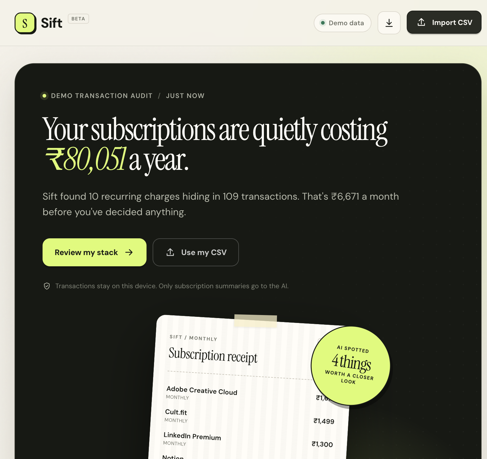
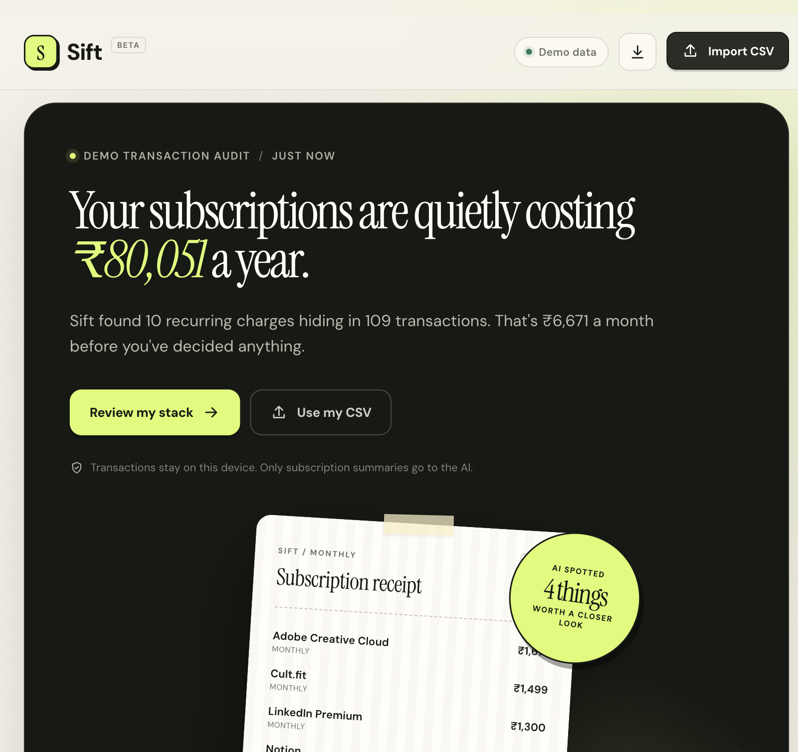
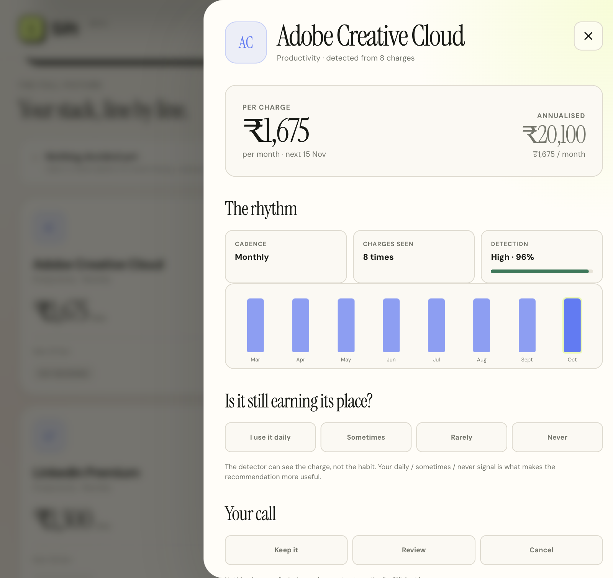
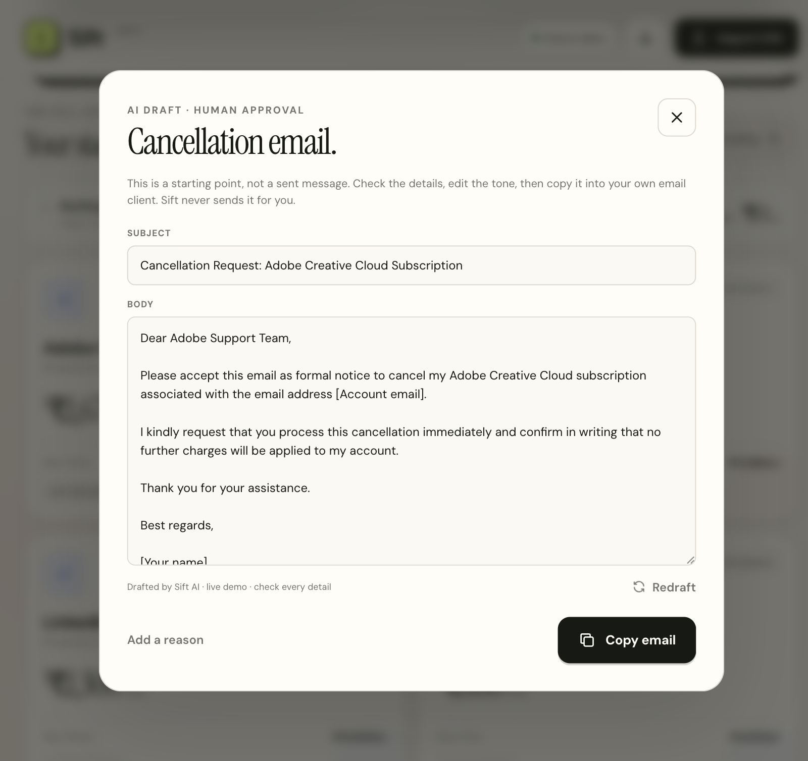

# Sift

**Find the subscriptions you forgot you had.**

Sift turns a bank or UPI CSV into a clear subscription audit, uses AI to explain where the money is leaking, and drafts cancellation emails only after a human decides. It is a small, local-first answer to subscription creep — built with Python, Flask, vanilla JavaScript and SQLite.



## The problem

Subscriptions are designed to be forgotten. A ₹119 Spotify charge is easy to ignore, but ten of them become ₹80,051 a year. Bank statements show the individual debits, not the pattern: which charges are recurring, when they renew, which ones increased in price, and which ones overlap.

Sift solves the last mile too. Finding the leak is not enough; someone has to decide whether a plan still earns its place and then write the awkward cancellation email.

## What it does

- **Reads common bank/UPI CSV exports** without assuming one bank format.
- **Detects recurring charges deterministically** using merchant normalisation, charge intervals, amount stability and recency.
- **Projects the next renewal** and annualises monthly, weekly, quarterly and yearly plans.
- **Surfaces price increases, category overlap and the next 30 days of renewals.**
- **Asks for the missing signal** — whether you actually use the subscription.
- **Generates a grounded AI savings brief** from derived subscription data only.
- **Turns a decision into a cancellation draft** that you can edit and copy. Nothing is sent automatically.
- **Exports the decision ledger as CSV.**

The seeded demo finds **10 active subscriptions** across **109 transactions**, costing **₹6,671/month** or **₹80,051/year**. It also catches a **20% Spotify price rise**, an annual Amazon Prime plan, two overlapping storage plans, and ignores a lapsed Audible plan and everyday noise such as groceries and cab rides.

| Detected plan | Cadence | Annual cost | Signal |
| --- | ---: | ---: | --- |
| Adobe Creative Cloud | Monthly | ₹20,100 | Largest single plan |
| Cult.fit | Monthly | ₹17,988 | Health spending |
| LinkedIn Premium | Monthly | ₹15,600 | Productivity overlap |
| Notion | Monthly | ₹9,600 | Productivity overlap |
| Netflix | Monthly | ₹7,788 | Entertainment |
| Disney+ Hotstar | Monthly | ₹3,588 | Entertainment |
| Google One | Monthly | ₹1,560 | Storage overlap |
| Amazon Prime | Yearly | ₹1,499 | Annual renewal |
| Spotify | Monthly | ₹1,428 | +20% price increase |
| iCloud+ | Monthly | ₹900 | Storage overlap |

## How it works

```text
Bank / UPI CSV
      │
      ▼
Python parser ──► deterministic detector ──► SQLite
                        │                      │
                        │ derived summary      │ latest analysis
                        ▼                      ▼
                 AI savings brief ◄──── Flask API ────► single-page UI
                        │                      │
                        ▼                      ▼
                 human decision ──► cancellation draft ──► copy & send yourself
```

### 1. Deterministic detection

The detector is deliberately explainable. It:

1. Normalises merchant descriptions such as `UPI-NETFLIX SUBSCRIPTION 882191` into `NETFLIX`.
2. Groups charges by normalised merchant.
3. Measures the gaps between charges and compares them with weekly, fortnightly, monthly, quarterly and yearly rhythms.
4. Requires **three monthly-ish charges** or **two yearly charges** before calling something recurring, which avoids treating two coincidental purchases as a subscription.
5. Rejects groups whose amounts vary by more than 38%.
6. Drops plans that stopped more than roughly two cycles ago, instead of projecting a renewal that will not happen.
7. Flags a price increase when the latest charge is at least 4% above the median of prior charges.

No transaction data leaves the machine during detection.

### 2. AI reads the summary, not the statement

The live model receives only the derived subscription records: merchant, category, amount, cadence, annualised cost, next renewal, price change, detector confidence, and the user's decision/usage. It never receives the raw transaction rows.

The model returns strict JSON containing a headline, a short summary, up to five recommendations and up to three watchouts. Sift then validates the response:

- Every merchant must match a detected subscription; invented merchants are dropped.
- A recommendation cannot cancel a plan the user marked **keep** or **daily**.
- A recommendation can cancel only when the user marked it **cancel** or **never**.
- Savings are recalculated in Python, not trusted from the model.
- Invalid JSON or a provider failure falls back to a transparent local coach.

The local coach is a real fallback, not an error screen. It uses the same detected data to flag price rises, category overlap, large plans and the user's own decisions. Set `AI_MODE=local` to use it exclusively.

### 3. Human approval by design

Sift **does not** connect to a bank, cancel a subscription, charge a card or send an email. It records a decision, prepares an editable draft and gives you a copy button. The expensive decision stays human.

| Step | Who does it | Automatic? |
| --- | --- | --- |
| Parse CSV | Python | Yes |
| Find recurring rhythm | Python | Yes |
| Explain and prioritise | AI + validation rules | Yes, after the summary is built |
| Decide keep / review / cancel | Human | No |
| Draft the cancellation email | AI or local template | Yes |
| Send the email | Human | No |

## Screenshots







## Run locally

Requires Python 3.10+ (3.11 recommended).

```bash
cd sift
python3 -m venv .venv
source .venv/bin/activate
pip install -r requirements.txt
python run.py
```

Open **http://127.0.0.1:5050**. The demo analysis is seeded automatically on first launch.

To reset the demo after making decisions:

```bash
curl -X POST http://127.0.0.1:5050/api/demo
```

Or open **Import CSV → Or load the demo data** in the UI.

### Use your own statement

1. Export transactions as CSV with at least `date`, `description` and `amount` columns.
2. Open **Import CSV** and choose the file (up to 2 MB).
3. Review the detected plans, mark usage and decisions, then generate a cancellation draft if needed.

A sample file is included at `data/sample_transactions.csv` and is also downloadable from the app.

## Tests

```bash
cd sift
.venv/bin/python -m unittest discover -s app -v
```

**20 tests pass.** The suite covers merchant normalisation, cadence detection, price increases, noise rejection, renewal projection, metrics, API seeding, decision persistence, CSV validation, export, AI JSON extraction, hallucinated-merchant rejection and the human-override rule. API tests run with `AI_MODE=local`, so they are deterministic and do not consume a live provider.

## Project structure

```text
sift/
├── app/
│   ├── __init__.py          # App factory export
│   ├── detector.py          # CSV parsing, normalisation, recurring detection
│   ├── coach.py             # Live AI, local fallback, email drafting, validation
│   ├── web.py               # Flask routes and demo seeding
│   ├── storage.py           # SQLite persistence
│   ├── templates/index.html # Single-page UI
│   └── static/              # CSS and vanilla JavaScript
├── data/
│   └── sample_transactions.csv
├── docs/
│   ├── submission.md        # Assignment write-up, sections 01–04
│   ├── submission.pdf       # Rendered submission
│   ├── build_pdf.py         # Reproducible Markdown → PDF build
│   └── screenshots/
├── run.py
├── requirements.txt
├── render.yaml
└── .env.example
```

There is no frontend build step. The browser loads one HTML page, one stylesheet and one JavaScript file.

## API

| Method | Route | Purpose |
| --- | --- | --- |
| `GET` | `/api/state` | Latest analysis and decisions |
| `POST` | `/api/analyze` | Upload and analyse a CSV |
| `POST` | `/api/demo` | Re-seed the sample analysis |
| `POST` | `/api/insights` | Run the live AI brief, with local fallback |
| `POST` | `/api/decision` | Save a human decision or usage signal |
| `POST` | `/api/email` | Draft an editable cancellation email |
| `GET` | `/api/export.csv` | Export the subscription ledger |
| `GET` | `/api/sample.csv` | Download the demo CSV |
| `GET` | `/api/health` | Health check |

## AI configuration

Sift works without an API key. The default `auto` mode tries a zero-key, OpenAI-compatible free endpoint and silently falls back to local logic if the provider is unavailable or rate-limited.

```bash
cp .env.example .env
```

```dotenv
AI_MODE=auto
AI_BASE_URL=https://algoholia.com/api/free-llm/v1
AI_MODEL=auto
AI_API_KEY=
```

For a private local model, point the same OpenAI-compatible client at Ollama:

```dotenv
AI_MODE=auto
AI_BASE_URL=http://localhost:11434/v1
AI_MODEL=llama3.2
AI_API_KEY=ollama
```

For no network calls at all:

```dotenv
AI_MODE=local
```

The free provider is rate-limited. Repeated live refreshes may fall back to the local coach; the UI labels that state as `LOCAL` and explains that no data left the device. For a production demo, use a keyed provider or a local model.

## Deployment

`render.yaml` is included as a Render blueprint:

```bash
# From the repository root
render blueprint launch
```

The start command is:

```bash
gunicorn run:app --bind 0.0.0.0:$PORT --workers 1 --threads 2 --timeout 60
```

SQLite is intentionally simple for this assignment. On an ephemeral host, the database and the latest analysis disappear on redeploy. A production version would use a managed database and per-user storage.

## Limits and sensible next steps

- **CSV, not a bank connection.** Sift audits an export; it does not sync accounts.
- **Merchant aliases are curated.** Unknown services can be detected, but their display names and categories may need a mapping.
- **Recurring means a stable rhythm.** Highly variable bills, annual plans with only one observed charge, and plans with gaps over two cycles may be missed.
- **INR is the primary display currency.** The detector records the dominant currency, but the UI formatter is currently INR-first.
- **Single-user by design.** There is no login, encryption at rest or multi-tenant isolation.
- **No automatic cancellation.** This is a deliberate safety property, not a missing integration.
- **The free AI tier is for demos.** Rate limits and cold starts make it unsuitable for production traffic without a keyed provider.

Next steps: learn merchant aliases from corrections, add renewal reminders, support multiple currencies, move to Postgres for deployment, and add optional bank/UPI aggregator ingestion with explicit consent.

## Assignment write-up

The full problem → approach → build → reflection narrative is in **[docs/submission.md](docs/submission.md)** and **[docs/submission.pdf](docs/submission.pdf)**.

To rebuild the PDF:

```bash
python docs/build_pdf.py
```
