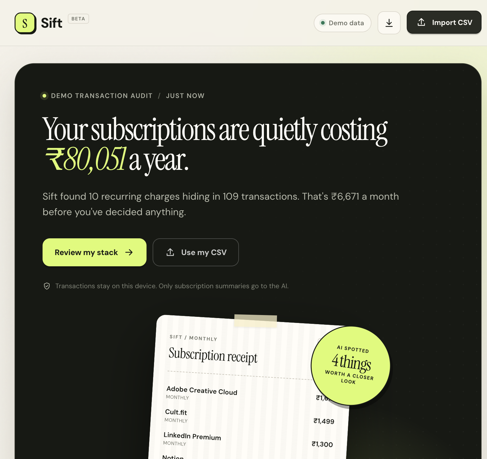
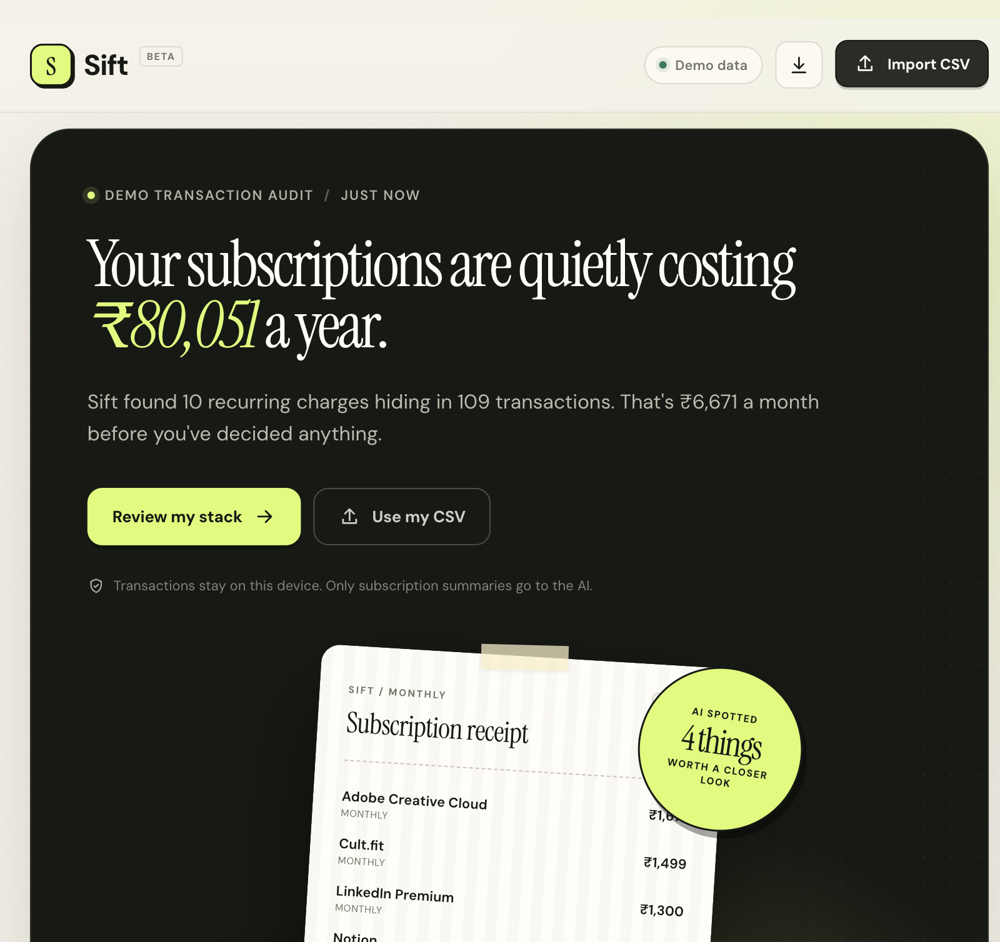
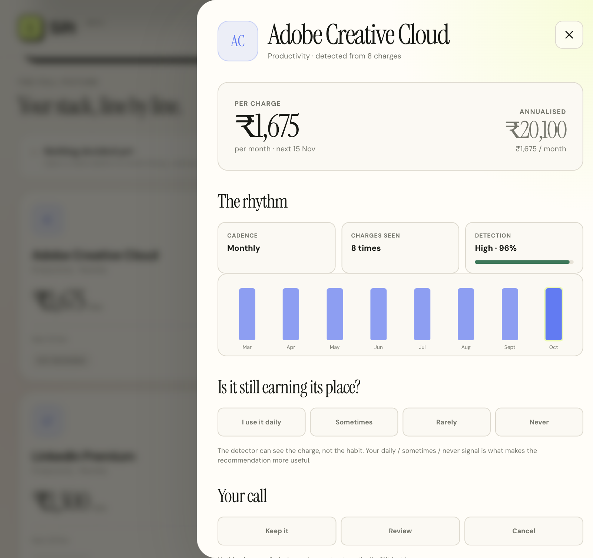
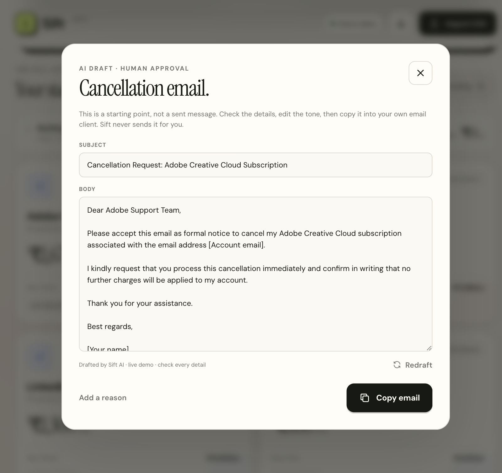

# Sift — Make AI Solve Something Real

**A local-first subscription auditor that finds recurring charges, explains the leak, and drafts the cancellation email — but never sends it for you.**

**Suryansh Chaurasiya · November 2026**

> The assignment: make AI solve something real. Sift is built around a real, unglamorous problem: the slow accumulation of subscriptions that are easy to start and easy to forget.

---

## 01 · The problem

### The bill you do not remember agreeing to

A single subscription is small enough to ignore. A ₹119 music plan, a ₹130 storage plan, a ₹649 streaming plan. The problem is not any one charge; it is the pile. Ten plans can quietly become ₹80,051 a year, and no bank statement presents them as a pile. It presents 109 individual debits.

The result is a familiar kind of financial fog:

- People can name their streaming services, but not their storage, productivity or fitness plans.
- Renewals arrive as a surprise even though the date has been predictable for months.
- Price increases are technically visible in the statement but practically invisible across months.
- Overlapping plans — two storage services, three productivity tools — are hard to compare because they do not sit next to each other.
- Even after someone spots the problem, cancellation is a second chore: finding the right page, writing the email, asking for written confirmation.

This is not a budgeting problem that a prettier chart solves. The missing pieces are **pattern detection, interpretation and follow-through**.

### The person and the job

The target user is someone with 8–20 active subscriptions who exports a bank or UPI statement occasionally. They do not want another finance app that asks for bank credentials. They want to answer three questions quickly:

1. **What am I actually paying for?**
2. **Which of these still earns its place?**
3. **Can you help me do something about it?**

The job to be done is not "show me a list of transactions." It is: *"Help me understand the recurring pattern in my own statement, make a decision I trust, and prepare the cancellation without taking control away from me."*

### Why AI belongs here — and where it does not

AI is good at turning structured facts into a clear explanation, noticing the strongest pattern among several plans, and writing the awkward first draft of a cancellation email. It is not a reliable source of truth for whether a charge repeated every 30 days.

Sift therefore splits the problem deliberately:

- **Python owns the facts.** Parsing, normalisation, cadence detection, renewal projection and arithmetic are deterministic and testable.
- **AI owns the interpretation.** It receives a compact summary of the detected plans and writes a prioritised brief.
- **The human owns the decision.** The application records a choice; it never cancels or sends anything.
- **Code validates the AI.** The model cannot invent a merchant, change the arithmetic, or override a human decision.

That division is the core design idea. The AI is useful because it is constrained, not because it is trusted with everything.

### Success criteria

A successful Sift build had to:

- run locally with no account and no API key;
- detect the sample subscriptions while ignoring ordinary spending;
- explain **why** it believes something is recurring;
- produce a useful brief even when the AI provider is unavailable;
- make the privacy boundary visible to the user;
- require human approval for every consequential action;
- be understandable in a code review and safe to iterate on.

---

## 02 · The approach

### The product idea

Sift is a one-page audit. The user drops in a CSV and gets:

- a total annual run-rate and a monthly equivalent;
- a receipt-like overview of the largest recurring charges;
- a card for each subscription with cadence, confidence, next renewal and annual cost;
- a chart of the charge history;
- a separate AI brief with recommendations and watchouts;
- a usage check-in and an explicit keep / review / cancel decision;
- an editable cancellation email draft.

I chose a single-page flow because the user's mental model is a pile, not a multi-step wizard. The first screen should already show the answer.

### Four design decisions

**1. Local-first, not bank-connected.**

The app never asks for banking credentials. It reads an exported CSV, parses it on the machine and stores the result in local SQLite. This reduces both scope and risk. It also makes the project demonstrable without third-party onboarding.

**2. Deterministic detection before generation.**

The recurring-charge detector is ordinary Python. It groups transactions, measures intervals, checks amount stability, discards stale rhythms and calculates confidence. No LLM decides whether Netflix is a subscription. This keeps the core fact base explainable and repeatable.

**3. AI as a grounded analyst, not an oracle.**

The model sees a derived summary: merchant names, categories, amounts, cadence, annualised cost, renewal dates, price changes, detector confidence and the user's decisions. It does not see raw transaction rows. It returns JSON, which is validated against the detector's own list. Savings are recomputed in Python.

**4. Human approval as a product feature.**

The app deliberately stops short of sending email or cancelling plans. It drafts, the user edits, the user copies. This is not a limitation hidden in the footer; it is part of the product promise and the UI language.

### Architecture

```text
┌──────────────────────────┐
│  Bank / UPI CSV export   │
└────────────┬─────────────┘
             │
             ▼
┌──────────────────────────┐
│  detector.py             │
│  parse → normalise →     │
│  group → cadence → score │
└────────────┬─────────────┘
             │ derived subscriptions
             ▼
┌──────────────────────────┐        ┌─────────────────────────┐
│  SQLite                  │◄──────►│  Flask API / web.py     │
│  latest analysis JSON    │        │  state, upload, demo,   │
└──────────────────────────┘        │  decisions, email       │
             │                      └────────────┬────────────┘
             │ summary only                      │
             ▼                                   ▼
┌──────────────────────────┐        ┌─────────────────────────┐
│  coach.py                │        │  Single-page UI         │
│  live AI or local coach  │───────►│  HTML + CSS + vanilla JS│
│  validation + fallback   │        │  no build step          │
└──────────────────────────┘        └─────────────────────────┘
```

The stack is intentionally small:

- **Flask** for the app factory and JSON API.
- **SQLite** for persistence; one analysis is stored as a JSON payload.
- **Vanilla HTML/CSS/JavaScript** for the interface; no Node, bundler or frontend framework.
- **requests** for the OpenAI-compatible provider call.
- **unittest** for the test suite; no extra test framework.

This keeps the repository understandable and the runtime light.

### What the AI actually receives

The model receives a compact JSON document rather than the statement. A simplified example:

```json
{
  "currency": "INR",
  "monthly_total": 6670.92,
  "annual_total": 80051.0,
  "subscription_count": 10,
  "subscriptions": [
    {
      "merchant": "Spotify",
      "category": "Entertainment",
      "amount": 119,
      "cadence": "monthly",
      "monthly_cost": 119,
      "annual_cost": 1428,
      "next_renewal": "2026-12-09",
      "price_increase": {
        "from": 99,
        "to": 119,
        "percent": 20,
        "annual_impact": 240
      },
      "detector_confidence": 0.98,
      "user_decision": "unreviewed",
      "user_usage": null
    }
  ]
}
```

Raw transaction references, original narration strings and individual transaction dates stay out of the prompt. The model is told explicitly not to invent usage, prices or dates, and not to imply that an email has been sent.

### Roles and responsibilities

| Capability | Deterministic code | AI | Human |
| --- | :---: | :---: | :---: |
| Parse CSV and normalise merchants | ● | | |
| Decide whether a pattern is recurring | ● | | |
| Project renewals and annualise cost | ● | | |
| Detect price increases and overlaps | ● | | |
| Write a prioritised savings brief | | ● | |
| Validate merchants and arithmetic | ● | | |
| Choose keep / review / cancel | | | ● |
| Supply the usage signal | | | ● |
| Draft a cancellation email | | ● | |
| Edit and send the email | | | ● |

The division is visible in the interface. The AI panel is labelled **LIVE** or **LOCAL**, the detail sheet says "nothing is sent automatically," and the email dialog says "human approval."

---

## 03 · The build

### 1. CSV parsing without assuming one bank

`detector.py` accepts common column names such as `transaction date`, `txn date`, `date`, `narration`, `description`, `merchant`, `amount`, `debit` and `currency`. It sniffs comma, semicolon and tab delimiters, tries several date formats, handles quoted amounts and parenthesised negatives, and skips credit/refund rows.

Every row that survives is normalised:

```text
UPI-NETFLIX SUBSCRIPTION 882191
    → uppercase
    → strip reference numbers and noise tokens
    → NETFLIX
```

The normalisation is important because bank narrations are messy. Without it, the same subscription looks like ten different merchants. A curated alias table maps known patterns to clean names and categories, while unknown merchants still get a readable fallback name.

### 2. Detecting the rhythm

For each normalised merchant, the detector:

1. Sorts charges by date.
2. Computes the gaps between consecutive charges.
3. Scores each gap against weekly (7 days), fortnightly (14), monthly (30), quarterly (91) and yearly (365) expectations.
4. Requires most gaps to fit the cadence and the median gap to sit near it.
5. Rejects groups with fewer than three charges for non-yearly rhythms, or fewer than two for yearly.
6. Rejects groups whose amounts vary by more than 38%.
7. Drops a plan if its last charge is more than 2.2 cycles old.
8. Projects the next renewal forward from the last charge.
9. Flags a price rise when the latest amount is at least 4% above the median of prior charges.
10. Assigns a confidence score based on charge count, cadence fit and amount stability.

The two-charge rule matters. During testing, two ordinary coffee purchases 30 days apart looked like a monthly subscription. Requiring three monthly-ish charges removed that false positive. Annual plans are the exception because waiting for a third annual charge would mean waiting two years.

The lapsed rule matters too. The sample deliberately contains an Audible plan that stopped charging. A naive projection would invent a renewal; Sift excludes it.

### 3. The seeded demo

The sample file contains 109 transactions across two years, including noise such as groceries, cab rides and one-off purchases. On 10 November 2026, the detector finds:

| Plan | Cadence | Annual cost | Why it is interesting |
| --- | ---: | ---: | --- |
| Adobe Creative Cloud | Monthly | ₹20,100 | Largest single plan |
| Cult.fit | Monthly | ₹17,988 | Health spending |
| LinkedIn Premium | Monthly | ₹15,600 | Productivity overlap |
| Notion | Monthly | ₹9,600 | Productivity overlap |
| Netflix | Monthly | ₹7,788 | Long, stable history |
| Disney+ Hotstar | Monthly | ₹3,588 | Entertainment |
| Google One | Monthly | ₹1,560 | Storage overlap |
| Amazon Prime | Yearly | ₹1,499 | Annual cadence |
| Spotify | Monthly | ₹1,428 | 20% price increase |
| iCloud+ | Monthly | ₹900 | Storage overlap |

The totals are **₹6,670.92/month** and **₹80,051/year**. Ten charges are due in the next 30 days, totalling **₹8,045**. The Spotify increase adds **₹240/year** at the current rhythm. A lapsed Audible plan is excluded.

### 4. The AI brief

The live path uses an OpenAI-compatible chat completion. The default configuration is a zero-key community endpoint (`https://algoholia.com/api/free-llm/v1`, model `auto`). The prompt asks for strict JSON with a headline, summary, recommendations and watchouts, plus explicit safety rules.

The response is passed through three layers:

**Extraction.** Models sometimes wrap JSON in markdown fences or add a sentence before it. `extract_json()` first tries the fenced block, then a raw decode, then scans for the first valid JSON object.

**Grounding.** Each recommended merchant must match a detected subscription by normalised name. Unknown merchants are dropped. If the model returns too few usable recommendations, the local coach fills the gap.

**Constraint.** The validator forces `keep` when the user has chosen keep or daily, and forces `cancel` only when the user has chosen cancel or never. It recalculates savings from the detected annual cost. It caps lengths and falls back to safe defaults for missing fields.

A live run produced this brief:

> **Annual subscription spend is ₹80,051 across ten active services.**
>
> Your total annual expenditure is ₹80,051, with Productivity services accounting for the largest share of your budget. A human usage check is required for all subscriptions to determine actual value.

It recommended review for Adobe, LinkedIn, Spotify and iCloud+, kept Amazon Prime as multi-category value, and surfaced three watchouts: Productivity spend of ₹45,300/year, the Spotify increase, and storage redundancy between Google One and iCloud+. The phrasing is grounded in the data and does not pretend to know usage.

### 5. The local fallback

The free provider is rate-limited, so the app cannot depend on it. The local coach uses transparent heuristics:

- surface the user's own cancel/never decisions;
- flag price increases with the calculated annual impact;
- flag overlapping storage and entertainment plans;
- flag large annual costs that have no usage signal;
- include at least one likely keep for balance;
- summarise upcoming renewals and total spend.

The UI labels this as **LOCAL** and says "no data leaves this device." The same feature set remains usable with no network.

### 6. The interface

The frontend is deliberately one page with one stylesheet and one script. The design uses a warm paper background, a dark hero, lime accents and a receipt metaphor. The receipt is not decoration: it mirrors the user's mental model of a bill.

Key interactions:

- **Import CSV** opens a drag-and-drop dialog with a 2 MB limit.
- **Demo data** reseeds the sample analysis.
- **Subscription cards** open a detail sheet with charge history, confidence, usage and decision controls.
- **AI recommendations** are clickable and open the relevant subscription.
- **Cancellation email** opens an editable draft with a copy button.
- **How the AI is used** explains the detection/validation/human-approval boundary.
- Responsive rules keep the layout usable on narrow screens.

The UI was smoke-tested in a browser at desktop and narrow widths. An early horizontal overflow around 816px was fixed before the final pass; the final check showed no console errors and working detail, decision and email dialogs.

### 7. Screenshots









### 8. Tests

The suite runs with `AI_MODE=local`, so it is deterministic and does not consume the live provider:

```bash
.venv/bin/python -m unittest discover -s app -v
```

**20 tests pass.** Coverage includes:

- merchant normalisation of real-looking UPI narrations;
- detection of monthly and yearly cadences;
- the Spotify price increase and its annual impact;
- rejection of grocery, cab and other noise;
- future renewal projection;
- metric consistency;
- unusable CSV rejection;
- demo seeding and API state;
- decision and usage persistence;
- valid CSV export;
- upload replacing the demo;
- AI JSON extraction from fenced and chatty responses;
- rejection of invented merchants;
- the human keep decision overriding a model cancellation;
- safe local email fallback.

Live AI was tested manually against the default provider: a brief returned in about 3.5 seconds and an email draft was generated successfully. The fallback path is tested automatically.

### 9. Running and using it

```bash
cd sift
python3 -m venv .venv
source .venv/bin/activate
pip install -r requirements.txt
python run.py
```

Open `http://127.0.0.1:5050`.

A typical session:

1. The demo is already loaded. Read the overview and the AI brief.
2. Open Adobe Creative Cloud. Note the eight observed charges and the projected renewal.
3. Mark usage as "Rarely" and the decision as "Cancel." The confirmed saving updates.
4. Open the cancellation draft. Edit the reason if desired, then copy it.
5. Import your own CSV, or reset the demo with `POST /api/demo`.

The app does not send the email. That step stays outside the system on purpose.

### 10. Repository shape

```text
sift/
├── app/
│   ├── detector.py       # parse, normalise, detect, metrics
│   ├── coach.py          # live AI, validation, local fallback, email
│   ├── web.py            # Flask routes, demo seeding, savings plan
│   ├── storage.py        # SQLite persistence
│   ├── templates/        # one page of semantic HTML
│   ├── static/           # CSS and vanilla JS
│   └── test_*.py         # detector, API and AI tests
├── data/sample_transactions.csv
├── docs/                 # this write-up, PDF and screenshots
├── run.py
├── requirements.txt
├── render.yaml
└── .env.example
```

---

## 04 · Reflection

### What worked

**The deterministic/AI split.** The most important decision was not to let the model decide what a subscription is. The detector gives Sift a fact base that can be tested, explained and audited. The model then does what it is actually good at: turning a list of facts into a readable, prioritised brief. This made both debugging and the privacy story simpler.

**The demo data.** A realistic CSV was more useful than a synthetic list of obvious subscriptions. It included messy narrations, varying dates, a lapsed plan, a price change, an annual plan, overlapping categories and everyday noise. The detector had to earn the result.

**The human-in-the-loop boundary.** It would have been easy to add a fake "cancel" button. Keeping the system at "draft and copy" made the product more honest and gave the UI a clear point of view. It also made the safety rule testable: the model cannot override a keep decision, and nothing is sent.

**The fallback.** The app remained fully demonstrable when the free provider failed. The local coach is not a stub; it produces a usable brief and the UI explains the mode.

### What failed, and what changed

| Failure | What happened | What I changed |
| --- | --- | --- |
| Unreliable free provider | Pollinations returned HTTP 402 Payment Required during testing. | Replaced it as the default with a zero-key OpenAI-compatible endpoint and kept the local fallback. |
| Rate limits and latency | The free endpoint is rate-limited and a live call takes roughly 3–4 seconds. | Added an explicit loading state, a cached latest brief, a clear provider label, and a local fallback on any error. |
| Inconsistent JSON | The model sometimes wrapped JSON in markdown or added conversational text. | Added fenced-block extraction, raw decode and a scan for the first valid object. |
| Hallucinated merchants | A model can name a service that is not in the data. | Every merchant is matched back to the detected list; unknown merchants are dropped. |
| Unsafe recommendations | A model could suggest cancelling something the user marked keep or daily. | The validator enforces the user's decision and the usage signal before display. |
| Untrustworthy arithmetic | Model-generated savings can be wrong. | Savings are recalculated in Python from detected annual costs. |
| Two-charge false positives | Two ordinary purchases 30 days apart looked monthly. | Monthly-ish cadences now require at least three charges; yearly requires two. |
| Lapsed subscriptions | A stopped plan was being projected into the future. | Plans whose last charge is more than 2.2 cycles old are excluded. |
| Narrow-screen overflow | The page could scroll horizontally around 816px during the first UI pass. | Added responsive rules and verified the final layout at a narrow viewport. |
| Raw-data privacy risk | Sending full transactions to a model would be unnecessary and invasive. | The prompt receives only derived subscription records; raw narration and transaction dates stay local. |

### What I would improve next

1. **Learn aliases from corrections.** If a user renames "Unknown Service" to a known brand, remember it rather than requiring a code change.
2. **Handle variable recurring bills.** Utilities and metered plans need amount bands and different confidence logic.
3. **Add renewal reminders.** A local notification before a known renewal would turn the audit into an ongoing habit.
4. **Support more currencies properly.** The detector records the dominant currency, but the UI formatter is INR-first.
5. **Move beyond one latest analysis.** A real user needs history, comparisons and per-user isolation.
6. **Add a keyed provider or local model.** The zero-key endpoint is excellent for a demo, not for production reliability.
7. **Use a managed database for deployment.** SQLite is ideal locally and fragile on ephemeral hosting.
8. **Consider a bank/UPI aggregator only with explicit consent.** The CSV path is deliberately narrow and privacy-preserving.

### Honest limitations

Sift is a working prototype, not a financial adviser or a bank integration. It can miss subscriptions with irregular amounts, very short histories, unknown merchant patterns or currencies outside its formatting assumptions. It stores one latest analysis per SQLite database, has no authentication and is designed for a single local user. The live AI provider is rate-limited. The app never sends email or cancels a plan.

Those limits are acceptable for the assignment because the core loop is real: **parse a statement, detect the pattern, explain it with grounded AI, let a human decide, and prepare the next action.** The system is deliberately small enough to inspect.

### Closing thought

The most interesting part of this project was not the model call. It was deciding where the model should stop. Subscription detection is a factual problem; explanation and drafting are language problems; cancellation is a human problem. Sift is useful because it assigns each part to the right layer.

That is the version of "AI solving something real" I trust: the AI makes the hard part easier, the code keeps it honest, and the human keeps the decision.
